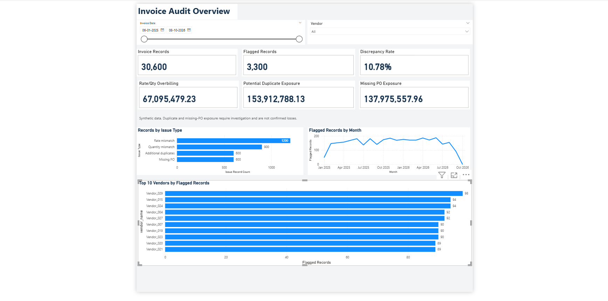
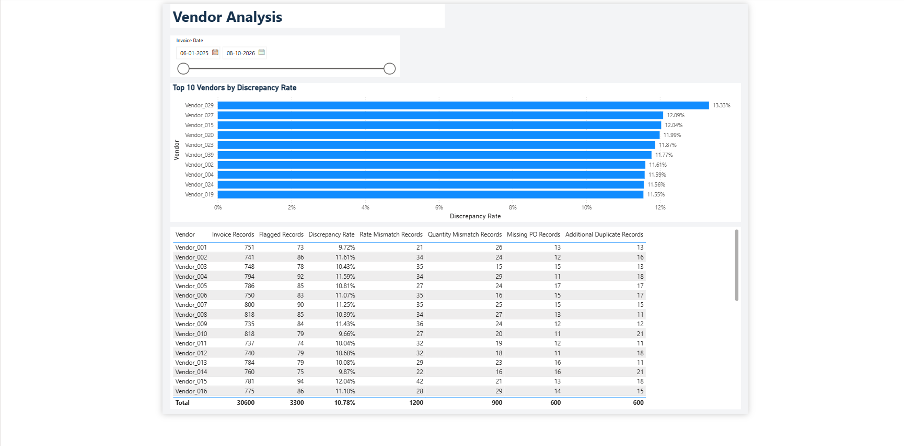
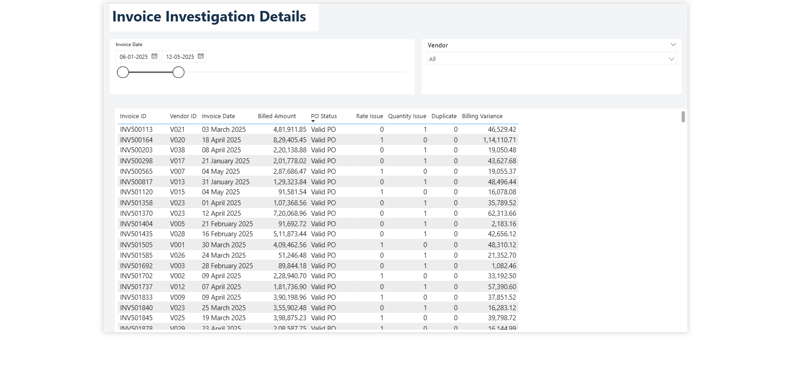

# Invoice & Billing Discrepancy Detector

An end-to-end data analysis portfolio project using Excel,
PostgreSQL and Power BI to detect invoice discrepancies
and support financial investigation.

## Problem Statement

Invoice records can contain incorrect rates, incorrect quantities,
repeated billing and missing purchase order references.

Checking these records manually is time-consuming and can make
it difficult to identify which invoices and vendors need attention.

## Objective

- Compare billed rates and quantities against purchase orders.
- Identify additional potential duplicate invoice records.
- Flag invoices without matching purchase orders.
- Calculate overbilling and amounts requiring investigation.
- Present findings through an interactive Power BI report.

## Dataset

The project uses synthetic data generated with Python.

| Dataset | Records |
|---|---:|
| Vendors | 40 |
| Contracts | 320 |
| Purchase Orders | 30,000 |
| Invoice Records | 30,600 |

Known errors were introduced into the dataset to validate
the detection logic. Error labels were used for validation,
not for identifying discrepancies.

## Tools and Approach

| Tool | Usage |
|---|---|
| Python | Generate synthetic data |
| Excel | Clean and validate data |
| PostgreSQL | Detect discrepancies and create reporting views |
| Power BI | Build measures, filters and dashboard pages |

### Workflow

1. Generated invoice and purchasing data using Python.
2. Checked missing values, duplicates, data types and amount
   consistency in Excel.
3. Used SQL joins, CASE expressions, CTEs and ROW_NUMBER()
   to detect invoice exceptions.
4. Created invoice-level, vendor-level and financial reporting views.
5. Built a three-page Power BI report with vendor and date filters.
6. Compared Power BI totals against SQL results.

## Key Findings

Out of 30,600 invoice records, 3,300 were flagged for review,
giving a discrepancy rate of 10.78%.

| Issue | Flagged Records |
|---|---:|
| Rate Mismatch | 1,200 |
| Quantity Mismatch | 900 |
| Additional Potential Duplicates | 600 |
| Missing Purchase Order | 600 |

Rate mismatches were the largest issue category, accounting
for 36.36% of flagged records.

The categories do not overlap in the current dataset.
The overall flagged count counts each record only once.

## Financial Findings

Amounts are expressed in dataset units; no currency is assumed.

| Metric | Amount |
|---|---:|
| Rate/Quantity Overbilling | 67,095,479.23 |
| Potential Duplicate Exposure | 153,912,788.13 |
| Missing PO Exposure | 137,975,557.96 |

Rate/quantity overbilling includes positive billing variance
for valid purchase orders and excludes additional duplicates.

Duplicate and missing-PO exposure represent amounts requiring
investigation. They are not confirmed payments, financial
losses or money recovered.

## Dashboard Preview

### Audit Overview

Shows invoice volume, flagged records, discrepancy rate,
financial metrics, issue breakdown, monthly trends and
vendors with the highest flagged counts.

### Vendor Analysis

Compares vendors using invoice counts, flagged counts,
discrepancy rates and issue categories. Includes a ranking
of the top 10 vendors by discrepancy rate.

### Invoice Details

Provides record-level investigation with vendor and date
filters. The table is restricted to records requiring review.

## Business Use

The report demonstrates how a finance team could:

- Prioritize invoices for investigation.
- Identify vendors with frequent billing exceptions.
- Distinguish review workload from discrepancy rates.
- Investigate financial amounts separately by issue type.

These are potential uses, not measured outcomes from a company.

## Project Files

| Folder | Contents |
|---|---|
| data/ | Original synthetic CSV files |
| excel/ | Cleaned Excel workbook |
| scripts/ | Python data generator |
| sql/ | Database tables, audit queries and reporting views |
| powerbi/ | Power BI report |
| screenshots/ | Dashboard page images |

## Limitations

- The dataset is synthetic and does not represent a real company.
- Quantity checks assume an invoice represents the full PO quantity;
  partial invoicing requires additional rules.
- Duplicate flags indicate matching billing records, not proof
  of duplicate payment.
- Missing purchase orders may reflect incomplete reference data.
- Partial months can affect the monthly trend.
- SQL scripts require database setup and CSV import.
  Detailed reproduction instructions are not included.
